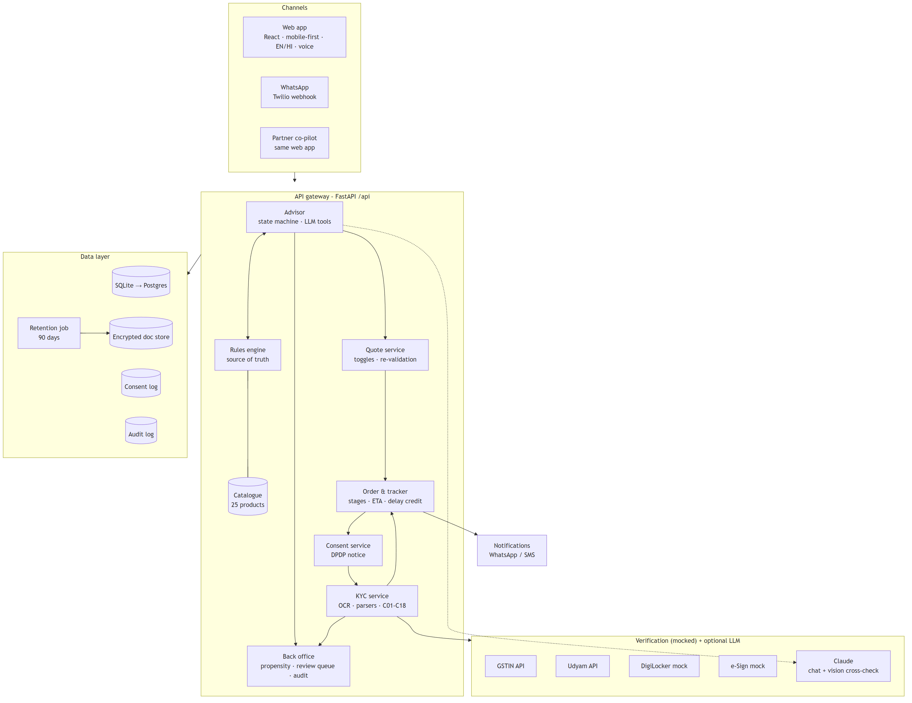

# Udyam Saathi by Accel Business

**Airtel Sync 2026 – Digital Track · Project Udyam Digital (Track A)**

A small-business owner discovers the right internet + phone + digital bundle, gets one transparent monthly price, completes KYC and tracks activation – **on a phone, in their language, in one sitting**. Today the same journey takes 10–14+ days, PDF quotes full of product codes, paper KYC and 3–4 status-chasing calls; only 7.4% of leads activate.



## Features

| Module | What it does |
|---|---|
| **Advisor** | Chat with quick-reply chips (and voice) in EN/HI; asks business type, staff, sites, city, current setup, needs, GSTIN; asks a clarifying question when an answer is vague. Optional AI mode (Claude) in 10 Indian languages – the LLM calls tools and can only get products from the rules engine. Works fully **without an API key** (guided mode). |
| **Rules engine** | Single source of truth for eligibility (city tier, staff, sites, active GSTIN, dependencies), segment bundles (Dukaan Digital, Office Pro, One Bill Multi-site, Factory Connect), quantities, pricing, savings line and plain-language "why". Raises if anything ineligible slips through. |
| **Quote & checkout** | One monthly price (excl. GST) + setup + contract; toggle add-ons and change quantities with live re-validation; WhatsApp share; print-to-PDF. |
| **Consent** | DPDP notice (what / why / who / how long / rights) recorded per order; KYC is blocked (403) without it. |
| **Smart KYC** | Upload 4 documents → OCR (watermark removal, blur score, deskew, Tesseract) → field parsers → 18 checks against the mock GSTIN/Udyam registries, lead records and today's date; plain fix-it messages per document; DigiLocker and Aadhaar e-sign mocks; demo loader for specimen applicants K01–K12. |
| **Tracker** | Stage timeline with expected dates (Sundays skipped), WhatsApp-style updates in EN/HI, technician card, proactive delay with apology + ₹100 credit, NPS and referral after activation. |
| **Back office** | Advisor leads not closed (with propensity score + next action), historical dropped leads ranked by the model, KYC review queue (approve/reject, audited full-ID view), rules audit of sold bundles. |
| **WhatsApp** | Twilio webhook driving the same advisor with numbered options. |

## Quick start

Prerequisites: Python 3.11+, Node 20+, and Tesseract for OCR (`sudo apt install tesseract-ocr` · `brew install tesseract` · Windows: [UB Mannheim installer](https://github.com/UB-Mannheim/tesseract/wiki), default path is auto-detected). Everything except document reading works without Tesseract.

```bash
cp .env.example .env            # optional – defaults work; add ANTHROPIC_API_KEY for AI mode

# Backend  →  http://localhost:8000  (docs at /docs)
cd backend
python -m venv .venv
.venv/Scripts/activate          # macOS/Linux: source .venv/bin/activate
pip install -r requirements.txt
python scripts/load_data.py     # builds backend/app.db from data/raw (the API also self-loads an empty DB)
uvicorn app.main:app --port 8000

# Frontend  →  http://localhost:5173  (Vite proxies /api to :8000)
cd frontend
npm install
npm run dev
```

Or with Docker: `docker compose up --build` (backend :8000, frontend :5173).

The case data lives in `data/raw/YTL_TrackA_Udyam_Digital_Data/`; if it's elsewhere, set `DATA_DIR` or the loader searches the workspace for `product_catalogue.csv`. "Today" is fixed to **2026-07-15** (`APP_TODAY`) for every date check.

### Environment

| Variable | Default | Purpose |
|---|---|---|
| `APP_TODAY` | `2026-07-15` | Date used by all date checks |
| `ANTHROPIC_API_KEY` | – | Enables AI mode (advisor + OCR vision cross-check) |
| `LLM_MODEL` | `claude-sonnet-5-5` | Model for AI mode |
| `DOC_ENCRYPTION_KEY` | generated dev key | Fernet key for documents at rest (`python -c "from cryptography.fernet import Fernet; print(Fernet.generate_key().decode())"`) |
| `BACKOFFICE_PIN` | `2026` | Back-office PIN (`X-Backoffice-Pin` header) |
| `FRONTEND_ORIGIN` | `http://localhost:5173` | CORS origin(s), comma-separated |
| `TESSERACT_CMD` | auto | Path to the tesseract binary |
| `TWILIO_AUTH_TOKEN` | – | Enables WhatsApp webhook signature validation |
| `VITE_API_URL` (frontend) | empty | Backend URL when not using the dev proxy |

## Tests

```bash
cd backend && python -m pytest -q          # 67 tests: validators, rules engine (500-profile property test),
                                            # 15 advisor scenarios, 12 KYC specimens, API, privacy/log masking, WhatsApp
cd e2e && npm install && npx playwright test smoke.spec.ts        # browser journey + EN/HI on every screen
npx playwright test screenshots.spec.ts                            # regenerates docs/screenshots/*
```

Playwright uses the installed Google Chrome (`PW_CHANNEL=chromium` after `npx playwright install chromium` otherwise). It reuses a backend already on :8000 or starts one.

Regenerate the docs: `python scripts/audit_sold_bundles.py` · `python scripts/calibrate_blur.py` · `python scripts/run_kyc_samples.py` · `python scripts/train_propensity.py` · `python scripts/analyze_leads.py` (run from `backend/`).

## Results

| What | Result | Detail |
|---|---|---|
| Advisor scenarios | **15/15** in guided mode | [docs/advisor_test_results.md](docs/advisor_test_results.md) |
| Never recommends an ineligible product | property test, 500 random profiles | `tests/test_rules_engine.py` |
| Rules audit | **48 / 368** sold bundles break rules (tier 24, GSTIN 12, dependency 9, employees 8) | [docs/rules_audit.md](docs/rules_audit.md) |
| Smart KYC | **12/12** specimen applicants match; primary flag caught 12/12 | [docs/kyc_results.md](docs/kyc_results.md) |
| Propensity model | ROC-AUC **0.68** (held-out 20%) | [docs/insights.md](docs/insights.md) |
| Lead insights | all case figures reproduced (CAC ₹15,053, churn 15.2%, …) | [docs/insights.md](docs/insights.md), `docs/charts/` |

## Privacy

Consent before KYC (403 otherwise), purpose limitation, no Aadhaar/PAN/DOB/bank data, identifiers masked in UI, APIs and logs (enforced by a test), documents Fernet-encrypted and never served, deletion 90 days after activation or on cancellation/withdrawal, audited reviewer access, address-only sharing with installers. One-page note: [docs/privacy_note.md](docs/privacy_note.md).

## Deploy

- **Backend → Render:** New → Blueprint → this repo (uses `render.yaml` + `backend/Dockerfile`, which installs Tesseract and loads the data on start). Set `FRONTEND_ORIGIN` to the Vercel URL, `DOC_ENCRYPTION_KEY`, `BACKOFFICE_PIN`, and optionally `ANTHROPIC_API_KEY`.
- **Frontend → Vercel:** import the repo with root directory `frontend`, framework Vite, env `VITE_API_URL=https://<your-render-service>.onrender.com`.

## Folder structure

```
backend/   FastAPI app (app/), data + analysis scripts (scripts/), pytest suite (tests/), Dockerfile
frontend/  React + Vite + TypeScript + Tailwind app (mobile-first, EN/HI)
e2e/       Playwright smoke test and screenshot capture
data/raw/  case dataset (CSVs + 47 KYC specimen images) – not modified
docs/      architecture, insights + charts, KYC results, rules audit, advisor results, privacy note, demo script, screenshots
lefts.md   build status, assumptions, what's left for humans
```

All businesses, people and identifiers are synthetic.
