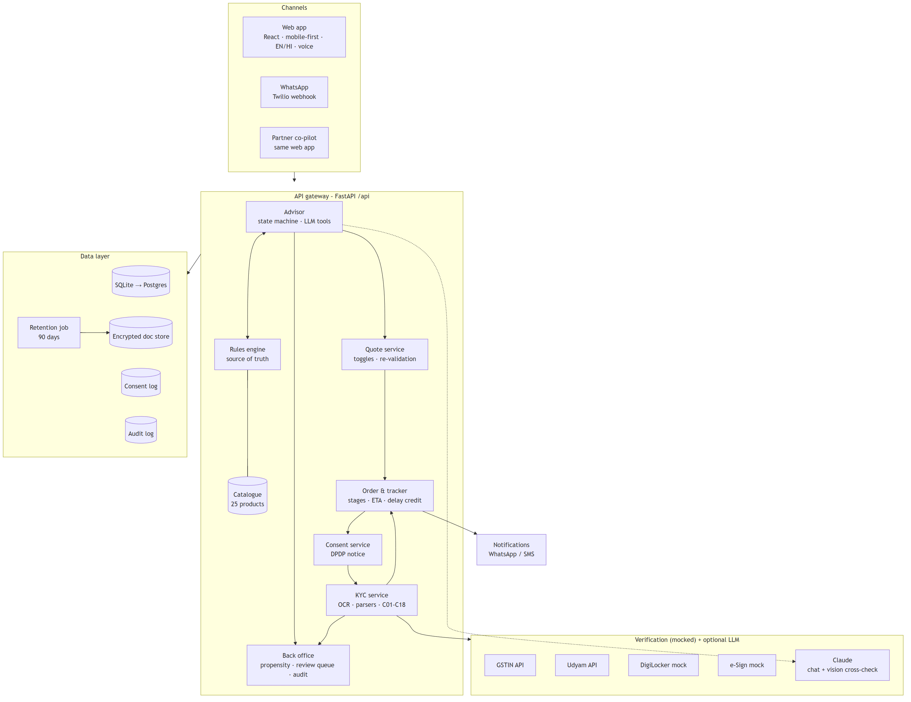
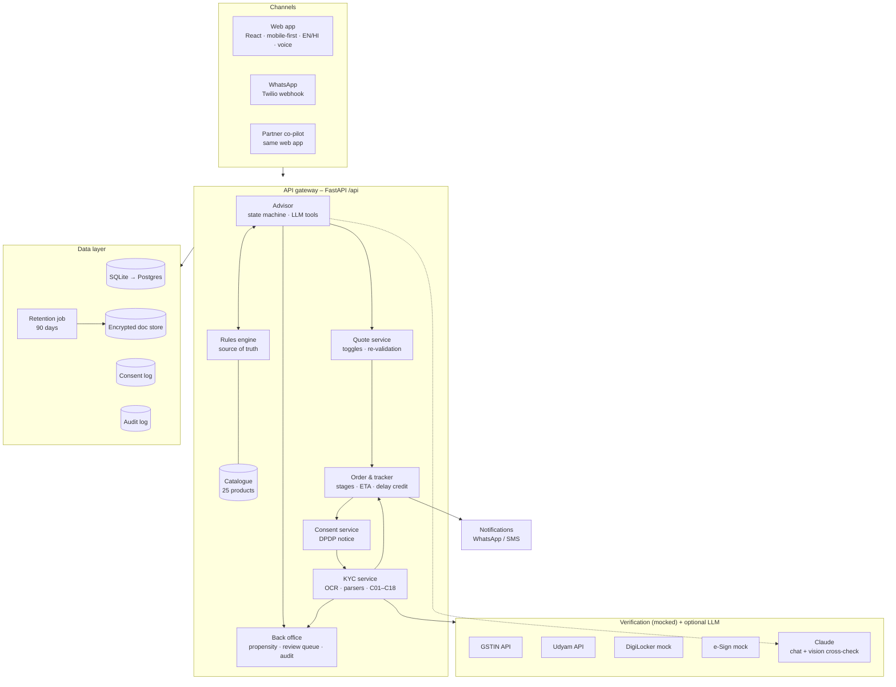

# Architecture – Udyam Saathi

## How a request flows

1. **Advisor** – the owner chats (web, voice or WhatsApp). In guided mode a deterministic state machine asks one question at a time with quick-reply chips; in AI mode Claude runs the conversation but can only get products through the `recommend_bundle` tool. Either way, every product comes from the **rules engine**, which re-checks city tier, staff, sites, GSTIN status and dependencies and raises if anything ineligible slips through.
2. **Quote** – one monthly price (excl. GST), setup and contract shown separately. Toggling items re-runs the rules engine; switching off the base connection also switches off what depends on it.
3. **Consent** – a DPDP notice (what, why, who, how long, rights) is recorded per order before any upload; KYC endpoints return 403 without it.
4. **Smart KYC** – documents are encrypted at rest. OCR (watermark removal, blur score, deskew, Tesseract) → field parsers → 18 checks against the GSTIN/Udyam registries, the lead record and today's date. Pass → `KYC_VERIFIED`; warnings → human review queue; failures → plain fix-it messages.
5. **Tracker** – stage dates from install lead times (Sundays skipped), proactive WhatsApp-style updates, automatic credit on delay, NPS + referral after activation.
6. **Back office** – unclosed advisor leads and dropped historical leads ranked by a propensity model, the KYC review queue, and the audit of 48 mis-sold bundles.

## Components

| Layer | Code |
|---|---|
| API | `backend/app/main.py`, `backend/app/routers/*` |
| Advisor + LLM | `services/advisor.py`, `services/llm_client.py` |
| Rules engine | `services/rules_engine.py`, `services/catalogue.py` |
| Quote / orders | `services/quote.py`, `services/tracker.py` |
| KYC | `services/kyc/{ocr,parsers,checks,service}.py` |
| Privacy | `utils/masking.py`, `services/storage.py`, `routers/privacy.py`, `routers/consent.py` |
| Back office | `routers/backoffice.py`, `services/propensity.py`, `services/audit.py` |
| Frontend | `frontend/` (React + Vite + TypeScript + Tailwind) |
