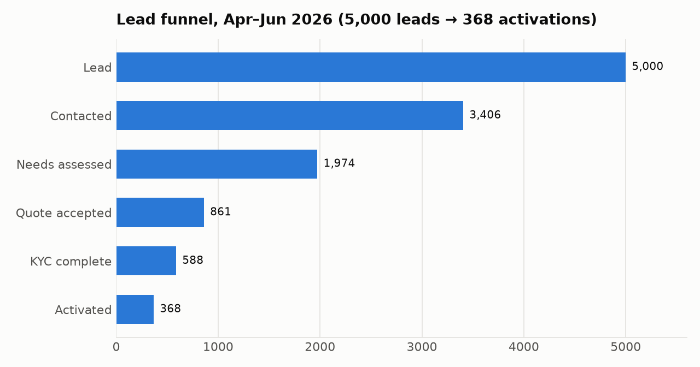
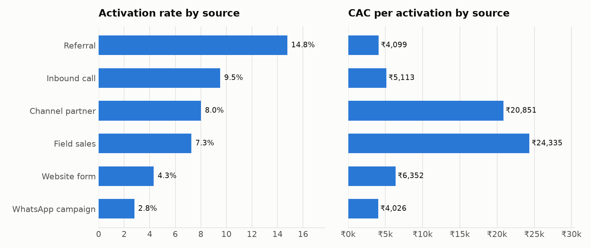
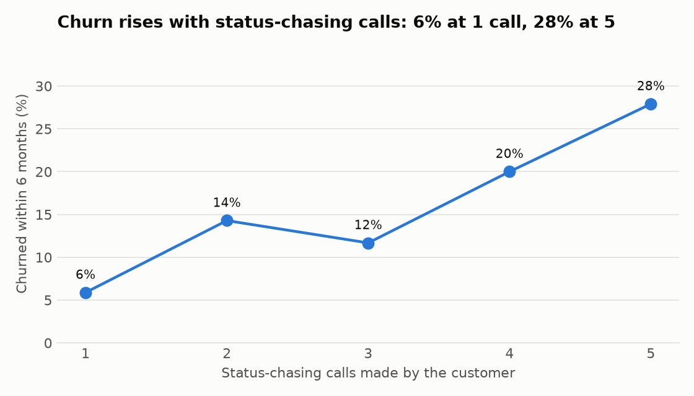
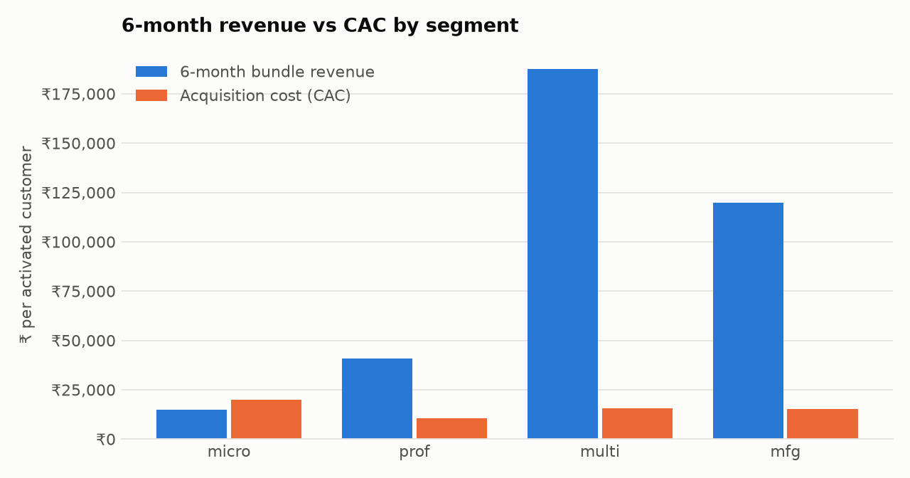

# Lead insights – Accel Business SMB funnel (Apr–Jun 2026)

Generated by `backend/scripts/analyze_leads.py` from `smb_leads.csv` (5,000 synthetic leads).

## Headline numbers

- **368 activations** from 5,000 leads → **7.4%** lead-to-activation
- **17.6 days** from lead to activation on average; 3.0 status-chasing calls per activated customer
- **CAC ₹15,053** per activation (total acquisition spend ₹5,539,640)
- **6-month churn 15.2%**
- Steepest drop: **needs assessed → quote accepted** – only 43.6% accept a quote
- **1,485 of 4,632 drops (32.1%) are fixable** by a digital journey (visit, quote and paperwork friction)

## Funnel

| Stage | Leads | % of previous |
|---|---|---|
| Lead | 5000 | – |
| Contacted | 3406 | 68.1% |
| Needs assessed | 1974 | 58.0% |
| Quote accepted | 861 | 43.6% |
| KYC complete | 588 | 68.3% |
| Activated | 368 | 62.6% |

Drop-off at each step: → Contacted: 31.9% lost; → Needs assessed: 42.0% lost; → Quote accepted: 56.4% lost; → KYC complete: 31.7% lost; → Activated: 37.4% lost.

## Lead source – activation and cost

| Source | Leads | Activations | Activation rate | CAC |
|---|---|---|---|---|
| Referral | 413 | 61 | 14.8% | ₹4,099 |
| Inbound call | 504 | 48 | 9.5% | ₹5,113 |
| Channel partner | 1010 | 81 | 8.0% | ₹20,851 |
| Field sales | 1720 | 125 | 7.3% | ₹24,335 |
| Website form | 995 | 43 | 4.3% | ₹6,352 |
| WhatsApp campaign | 358 | 10 | 2.8% | ₹4,026 |

Referral converts at **14.8%** with CAC **₹4,099**; field sales converts at **7.3%** with CAC **₹24,335** – about 6× the cost. → The tracker's referral card and a digital-first journey attack the most expensive channel.

## Status-chasing calls drive churn

| Follow-up calls | Activated customers | Churn within 6 months |
|---|---|---|
| 1 | 34 | 5.9% |
| 2 | 84 | 14.3% |
| 3 | 137 | 11.7% |
| 4 | 70 | 20.0% |
| 5 | 43 | 27.9% |

1 call → 5.9% churn; 5 calls → 27.9%. → The tracker must be **proactive** (WhatsApp-style updates, delay + credit before the customer asks).

## GSTIN

Leads with a GSTIN activate at **9.6%** vs **2.0%** without (1,466 leads have no GSTIN). → Offer a **no-GST starter bundle** (Dukaan Digital without GST-only products) and show what unlocks once a GSTIN is added.

## Segments

| Segment | Leads | Activations | Activation rate | Avg bundle ₹/month | 6-month revenue | CAC |
|---|---|---|---|---|---|---|
| micro | 2709 | 110 | 4.1% | ₹2,505 | ₹15,029 | ₹20,007 |
| prof | 1247 | 138 | 11.1% | ₹6,796 | ₹40,775 | ₹10,695 |
| multi | 755 | 83 | 11.0% | ₹31,233 | ₹187,401 | ₹15,614 |
| mfg | 289 | 37 | 12.8% | ₹19,980 | ₹119,878 | ₹15,324 |

Micro shops are 54% of leads but convert at 4.1% and cost more to acquire than they pay in six months – the self-serve advisor is the only economical way to serve them.

## Language

| Language | Leads | Activation rate |
|---|---|---|
| Punjabi | 96 | 4.2% |
| Tamil | 207 | 4.3% |
| Kannada | 253 | 5.1% |
| Gujarati | 233 | 6.0% |
| Marathi | 505 | 6.3% |
| Telugu | 207 | 7.7% |
| Hindi | 2137 | 7.9% |
| English | 1168 | 8.0% |
| Malayalam | 83 | 8.4% |
| Bengali | 111 | 9.0% |

Tamil, Punjabi and Kannada leads convert at roughly half the Hindi/English rate → **vernacular advisor** (EN/HI guided mode; all 10 languages in AI mode; voice input).

## Drop reasons

| Drop reason | Leads | Fixed by |
|---|---|---|
| Unreachable after 3 attempts | 805 | – |
| Owner had no time for a visit | 531 | No visit: advisor + KYC on the phone |
| Not interested on first call | 470 | – |
| Price too high | 414 | – |
| Locked in with current provider | 325 | – |
| Wrong or invalid number | 319 | – |
| Visit not scheduled by sales | 296 | No visit: advisor + KYC on the phone |
| Only wanted a mobile plan | 280 | – |
| Competitor offered cheaper plan | 207 | – |
| Quote too complex to understand | 206 | One plain-language monthly price |
| Quote took too long to arrive | 179 | Instant quote from the rules engine |
| Decided to wait | 107 | – |
| Installation delayed beyond 21 days | 98 | – |
| Missing GST or Udyam document | 94 | Smart KYC with fix-it messages; no-GST starter |
| Found paperwork too long | 79 | 5-minute Smart KYC |
| Authorised signatory not available | 53 | Remote e-sign (Aadhaar OTP) |
| Customer cancelled before install | 53 | – |
| Document details did not match | 47 | Live document checks before submission |
| Site not feasible for fibre | 41 | – |
| First payment failed | 28 | – |

Fixable total: **1,485 of 4,632**.

## Mis-sold bundles

48 of the 368 sold bundles (13%) break catalogue rules (city tier 24, GSTIN 12, dependency 9, employees 8) – see `rules_audit.md`. → The rules engine is the single source of truth for every recommendation.

## Most-sold products

| Product | Bundles |
|---|---|
| P08 | 192 |
| P01 | 180 |
| P07 | 176 |
| P16 | 175 |
| P02 | 101 |
| P23 | 84 |
| P20 | 83 |
| P19 | 80 |
| P09 | 80 |
| P22 | 62 |

## Propensity model (back office)

Logistic regression (one-hot categorical + log-scaled size/spend, `class_weight='balanced'`), 80/20 stratified split: **ROC-AUC 0.68** on the held-out 20%. Scores are shown as 0–100 (Hot ≥ 70, Warm 40–69, Cold < 40).

| Feature | Coefficient |
|---|---|
| lead_source_WhatsApp campaign | -0.994 |
| lead_source_Referral | +0.950 |
| segment_Micro retail & services | -0.811 |
| has_gstin_N | -0.702 |
| has_gstin_Y | +0.606 |
| lead_source_Website form | -0.584 |
| preferred_language_Tamil | -0.520 |
| preferred_language_Kannada | -0.351 |
| lead_source_Inbound call | +0.333 |
| segment_Small multi-site businesses | +0.301 |
| city_tier_2 | -0.298 |
| segment_Small manufacturers | +0.286 |
